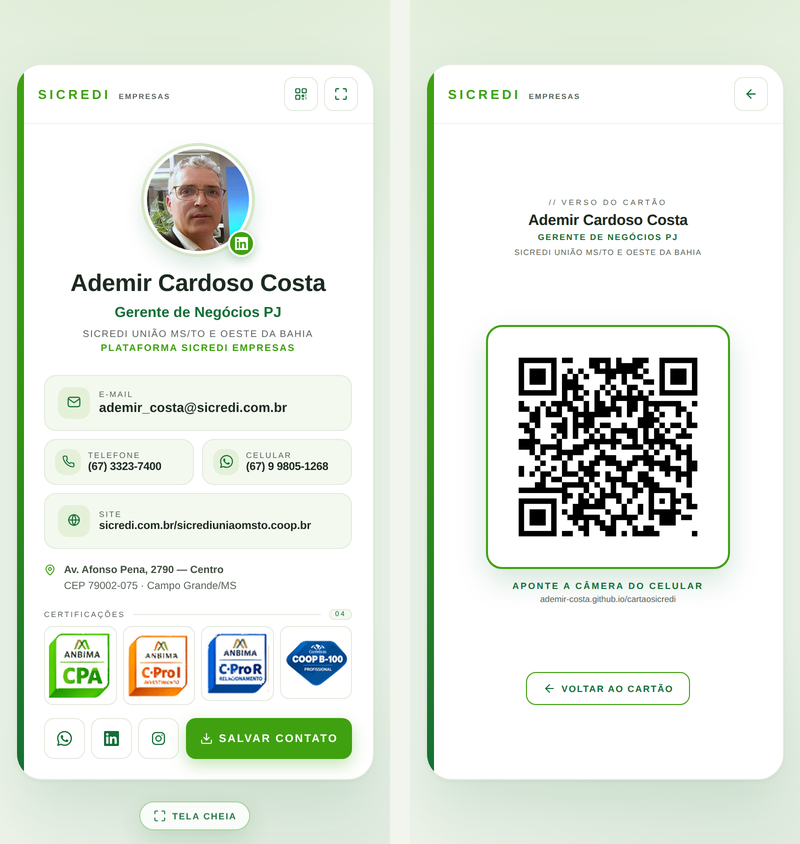

# Cartão de Visita Digital — Sicredi

Versão profissional do cartão, no padrão visual do Sicredi (verde oficial + branco), em **arquivo único** (`index.html`), sem dependências externas.



## Cores (manual da marca Sicredi)

| Uso | Cor |
|---|---|
| Verde Sicredi (digital) | `#3FA110` |
| Verde escuro | `#146E37` |
| Neutro claro | `#D7E6C8` |
| Branco | `#FFFFFF` |

Fonte: [Central da Marca Sicredi — Cores](https://marca.sicredi.com.br/cores/)

## O que o cartão tem

- **Foto** circular com selo do LinkedIn; o clique abre o seu perfil.
- **Nome, cargo e unidade** (Sicredi União MS/TO e Oeste da Bahia · Plataforma Sicredi Empresas).
- **Contatos clicáveis**: e-mail (`mailto`), telefone (`tel`), celular (WhatsApp) e site.
- **Endereço** da agência.
- **Certificações**: CPA, CPro-I, CPro-R e COOP B-100 — ao clicar, abre um painel com **o que é a certificação**, **o que ela garante para o cliente** e **o que ela habilita o profissional** a fazer.
- **Redes**: WhatsApp, LinkedIn e Instagram.
- **Salvar contato**: baixa um `.vcf` com todos os dados.
- **Verso com QR Code** (o cartão vira em 3D), apontando para o endereço publicado.
- **Tela cheia**: tenta abrir automaticamente; se o navegador bloquear, mostra a pílula "tela cheia" e ativa no primeiro toque.

## Textos das certificações

Ficam no objeto `DETALHES`, logo abaixo do `CONFIG` — um bloco por certificação, com três campos:

```js
"CPA": {
  oque:         "o que a certificação é e o que ela avalia",
  cliente:      "o que ela garante para quem é atendido",
  profissional: "o que ela habilita o profissional a fazer",
  fonte:        "ANBIMA · anbima.com.br"
}
```

Conteúdo baseado nas páginas oficiais da [ANBIMA Edu](https://anbimaedu.com.br/certificacoes) e da [Certificadora Confebras](https://certificadoraconfebras.coop.br/certificacoes/coopb-100/).

## Como editar

Abra o `index.html` e altere apenas o objeto `CONFIG` (no início do `<script>`):

```js
const CONFIG = {
  nome:       "Ademir Cardoso Costa",
  cargo:      "Gerente de Negócios PJ",
  unidade:    "Sicredi União MS/TO e Oeste da Bahia",
  plataforma: "Plataforma Sicredi Empresas",
  email:      "ademir_costa@sicredi.com.br",
  telefone:   "(67) 3323-7400",
  celular:    "(67) 9 9805-1268",
  whats:      "5567998051268",
  endereco:   "Av. Afonso Pena, 2790 — Centro",
  cidade:     "CEP 79002-075 · Campo Grande/MS",
  site:       "sicredi.com.br/sicrediuniaomsto.coop.br",
  linkedin:   "https://www.linkedin.com/in/gerenteademirccosta/",
  instagram:  "https://instagram.com/ademir_costa.40",
  qrLink:     "https://ademir-costa.github.io/cartaosicredi/"
};
```

> **Atenção ao QR:** a imagem do QR já está embutida e aponta para `https://ademir-costa.github.io/cartaosicredi/`.
> Se publicar em outro endereço, o QR precisa ser regerado — a legenda abaixo dele acompanha o `qrLink`, mas a imagem não.

## Publicar no GitHub Pages

1. Crie o repositório (sugestão: `cartaosicredi`).
2. Envie o `index.html` para a raiz.
3. Settings → Pages → Branch `main` / pasta `/ (root)` → Save.
4. O cartão fica em `https://SEU-USUARIO.github.io/cartaosicredi/`.

## Imagens dos selos

Os arquivos originais ficam em `assets/` (`CPA.png`, `cproi.png`, `cpror.png`, `coopb100.png`) e são a base das versões embutidas no HTML — ampliadas com Lanczos e leve nitidez, sem recorte da arte. Na COOP B-100 foi removida apenas a faixa alaranjada de 2 px que vinha na borda esquerda do arquivo original.

## Observação

As imagens (foto, selos e QR) vão embutidas em base64 dentro do `index.html` — por isso o arquivo funciona sozinho, mesmo aberto direto do disco, sem a pasta `assets`.
